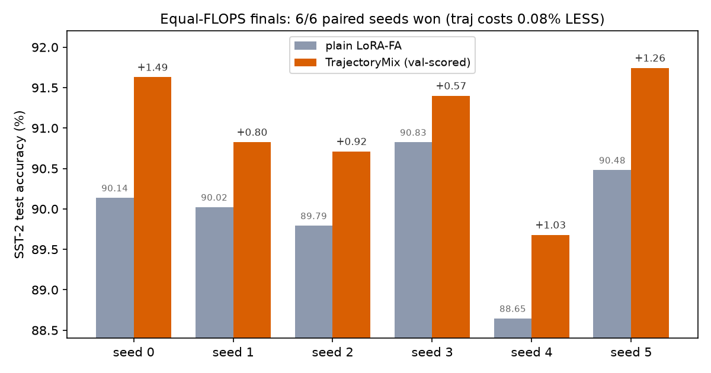
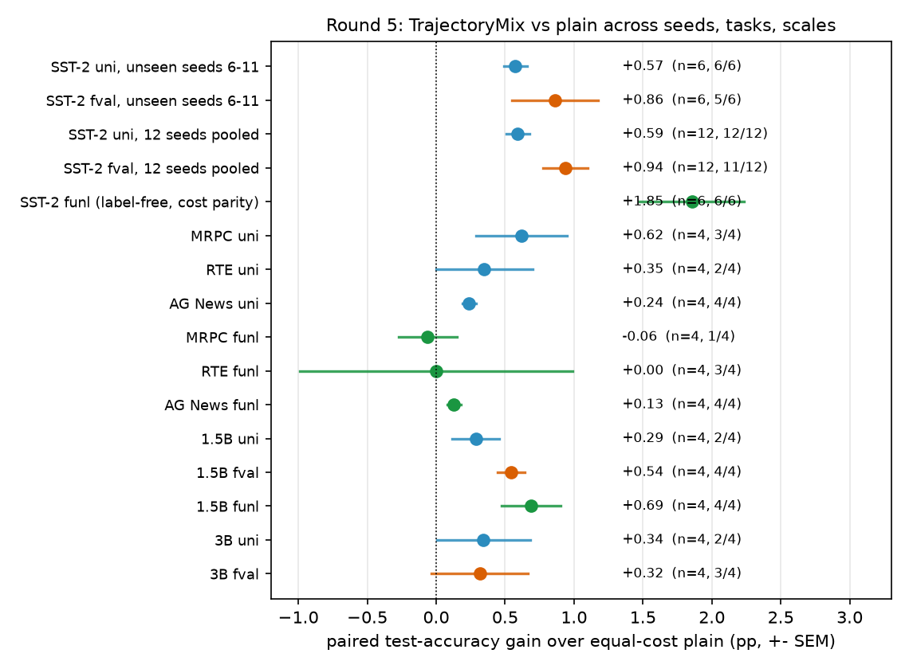

# updatemix

**Record a fine-tuning trajectory, then mix it.** `updatemix` implements
endpoint-mixture updatemix for LoRA: snapshots of the adapter along the
training trajectory are averaged (SWA-class) and/or mixed with weights
selected on held-out data — committed once, at the end, with zero
inference overhead and an honest, *equal counted FLOPS* budget.

## Headline result (equal-FLOPS study, SST-2, Qwen2.5-0.5B, 12 paired seeds)

| method | SST-2 test acc | vs plain | counted fwd-bwd tokens |
|---|---|---|---|
| plain LoRA-FA (tuned lr)  | 90.09 ± 0.65 | —      | 1,000,277 avg |
| TrajectoryMix, uniform w  | 90.68        | **+0.59** (t=7.01, **12/12** paired seeds) | equal, exactly |
| TrajectoryMix, val-scored w | 91.03    | **+0.94** (t=5.74, 11/12 paired seeds) | **−0.08%** — strictly cheaper every seed |
| TrajectoryMix, label-scored on raw text | **91.84** | **+1.85** (t=4.90, 6/6, strict cost parity) | +0.007% |

Seeds 0–5 drove selection; seeds 6–11 ran after, frozen, and confirm the
effect out-of-sample (+0.57, t=6.85, 6/6). Every selection used a held-out
val split; the official 872-example test split stayed untouched by training
*and* selection. Full write-up: [study/RESULTS.md](study/RESULTS.md).




## Install

```bash
git clone <this-repo> && cd updatemix
pip install -e .        # requires torch; examples also use transformers/datasets
```

## Try it

```bash
python examples/trajectory_mix_toy.py   # CPU, seconds — why mixing beats the endpoint
python examples/quickstart_sst2.py      # GPU — the study recipe condensed to ~150 lines
```

Verified output:

```
counted fwd-bwd tokens: 617872
committed mixture weights: [0.076, 0.267, 0.464, 0.093, 0.1]
val  acc: 0.8867
test acc: 0.9117
```

## Core usage (10 lines)

```python
import updatemix as um

rec = um.attach(model, ["*q_proj*", "*v_proj*"], rank=32, seed=0)
h = um.TrajectoryMix(rec, loss_fn, stride=16, window=4, n_levels=3,
                     tail=8, reweight_epochs=2, reweight_lr=0.1,
                     final_batches=16)
opt = torch.optim.AdamW(h.parameters(), lr=1e-3)
for batch in data:
    h.train_step(opt, batch)     # identical to plain steps; snapshots B
h.set_score_data(val_batches)    # optional: score mixture weights on val
h.flush()                        # B <- mix of trajectory tail (one time)
```

`reweight_epochs=0` gives costless uniform averaging (SWA); `>0` fits
softmax mixture weights on `set_score_data` batches via autograd — a
handful of extra forward/backward passes that your `loss_fn` can count
(see the equal-FLOPS accounting below). The scoring batches need not be
*labeled*: pass raw text with `labels = input_ids` and `loss_fn` becomes
an unsupervised LM scorer — that variant posted the best measured number
(+1.85, Round 5 of the study). `alpha` interpolates toward the mixture;
`decay` sets a geometric recency prior. `h.committed` exposes the final
weights per module.

## Why it works

Fine-tuning endpoints are *noisy samples of the basin*, not the basin
center. Probing every mixture candidate individually at flush
(`study/dyn.sh`, fig6): candidates swing over 2.1 pts on test, and the
live endpoint where plain stops is one of the **worst** — the mixture
lands +1.2–1.5 above it and +0.8 above the candidates' mean. Gains grow
with gradient noise (+1.53 overall in a high-noise bs-4 regime, **+2.35
at lr ≥ 3e-3**, ≈0 at low noise) — the exact signature of variance
reduction. Train accuracy saturates at ~30% of the budget while test
oscillates; averaging removes the oscillation, it does not "fit more".
Details: [study/RESULTS.md](study/RESULTS.md) ("Why averaging wins").

## Equal-FLOPS accounting

Every grad-carrying pass in both arms — training *and* the flush-time
weight fitting — goes through the same `loss_fn`, which counts
`input_ids.numel()` forward-backward tokens. The val-scored arm trains
~19 fewer steps to pay for scoring and still wins on 11/12 pooled seeds
while costing *less* in total. Final evals are forward-only and uncounted
in both arms.

## API overview

| entry | what |
|---|---|
| `um.attach(model, targets, rank, seed)` | LoRA-FA holders on name-matched modules (`Recorder`) |
| `um.TrajectoryMix` | the winner above: snapshot → hierarchical bin averages → one-time tail mixture at `flush()` |
| `um.Hierarchy` | merge-based reweighting during training (round 1 of the study — **negative result**, kept for honesty) |
| `um.attach` → `rec.save` / `um.UpdateLog.load` → `um.attach_mixture` | two-phase variant: log a run, replay-reweight another copy, `mix.fold()` for a zero-overhead deploy (`B_eff = T·softmax(w)@dB` starts at exactly B_T) |
| `um.fold_holders(model)` | fold LoRA delta into the base weights |
| `um.Muon`, `um.newton_schulz5` | Newton–Schulz-5 Muon optimizer helper |

## Reproducing the study

Runs on a single GPU; model via `UPDATEMIX_MODEL=/path` or the HF
id (default `Qwen/Qwen2.5-0.5B-Instruct`).

```bash
cd study
bash finals2.sh                                   # plain vs uniform traj, 6 seeds
TRAJ_ARGS="--frw 2 --frlr 0.1 --levels 3 --fval --fb 16" TRAJ_CAP=980000 bash finals3.sh
bash dyn.sh                                       # accuracy dynamics + endpoint probes
bash queue.sh                                     # Round 5: unseen-seed confirm, --funl,
                                                  #   MRPC/RTE/AG News, 1.5B scale
bash queue2.sh                                    # Round 5: strict-parity --funl,
                                                  #   --funl cross-task/1.5B, 3B scale
python3 analyze5.py                               # all Round-5 paired stats
python3 make_figs.py; python3 fig7.py             # regenerates study/figs/*.png
```

One run ≈ 1–7 min; the original suite ≈ 2 h, both Round-5 queues ≈ 2.5 h.
All raw results are committed as JSONL next to the
scripts — every number in RESULTS.md is recomputable from them.

## Tests

```bash
python tests/test_traj.py              # CPU: mixture math, commit exactness, grads vs autograd
python tests/test_merge_isolation.py   # CPU: merges touch nothing else
python tests/test_gpu_hier.py          # GPU: end-to-end on real modules
```

## Limitations (read before citing)

Round 5 of the study (121 new GPU runs) attacked the original caveats;
what survives, with evidence:

- **Not val-overfitted** (was: mild risk): the frozen recipe was re-run
  on seeds 6–11 never used for any selection — uniform +0.57 (t=6.85,
  6/6), val-scored +0.86 (5/6). Same magnitude out-of-sample.
- **Not one-task, not one-size** (was: SST-2 / 0.5B only): frozen recipe,
  no per-task tuning — positive on MRPC (+0.62), RTE (+0.35), AG News
  (+0.24, 4/4); positive at 1.5B (+0.54 fval 4/4, +0.69 label-free 4/4)
  and 3B (+0.34). But **magnitude decays as the base endpoint gets
  stronger** (90→94 test), and cross-task n=4 gives weaker significance
  than SST-2; treat +0.6 as the robust transfer number, +0.9..+1.9 as
  SST-2-specific.
- **No task labels needed** (was: strongest variant required a labeled
  val set): scoring the mixture on external *unlabeled* text via LM loss
  (`set_score_data` with `labels=input_ids`) gives the best measured
  result — +1.85 at strict cost parity, beating the labeled variant.
  That big gain was SST-2-specific; elsewhere the label-free scorer is
  neutral (never harmful). The uniform variant still needs nothing at
  all.
- LoRA-FA only; single GPU-scale study; task is short-text
  classification.
- `Hierarchy` (merge-based updatemix) **lost** to plain in round 1; the
  field-measured negative is in RESULTS.md and stands.

MIT licensed.
