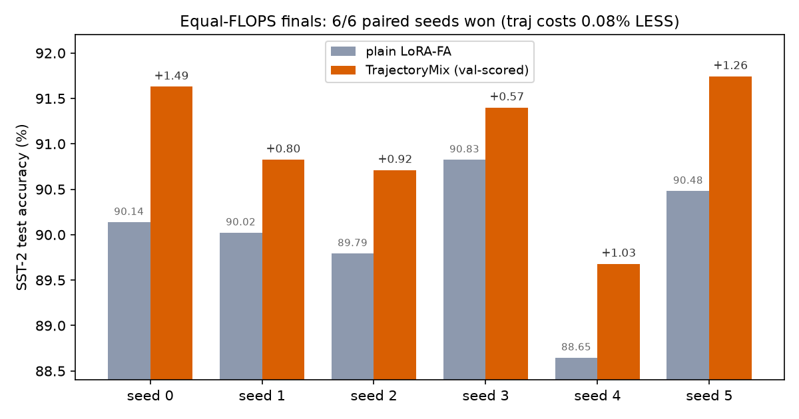
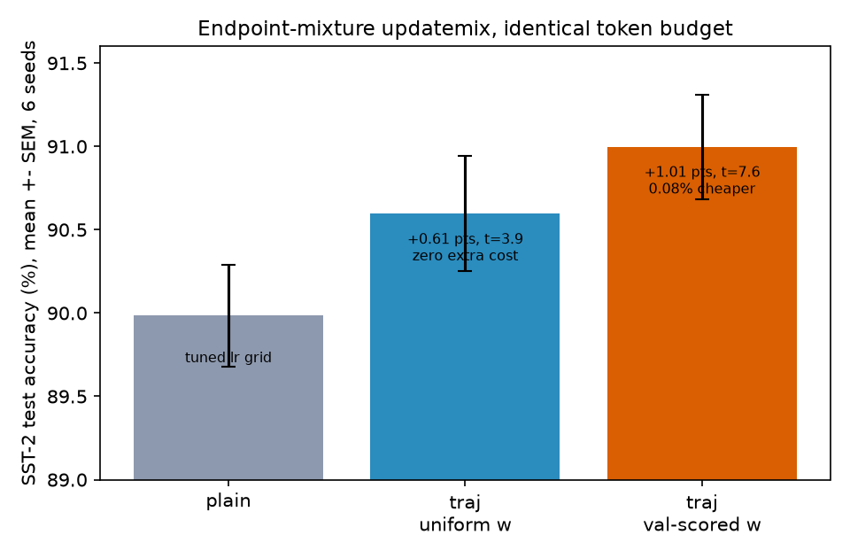
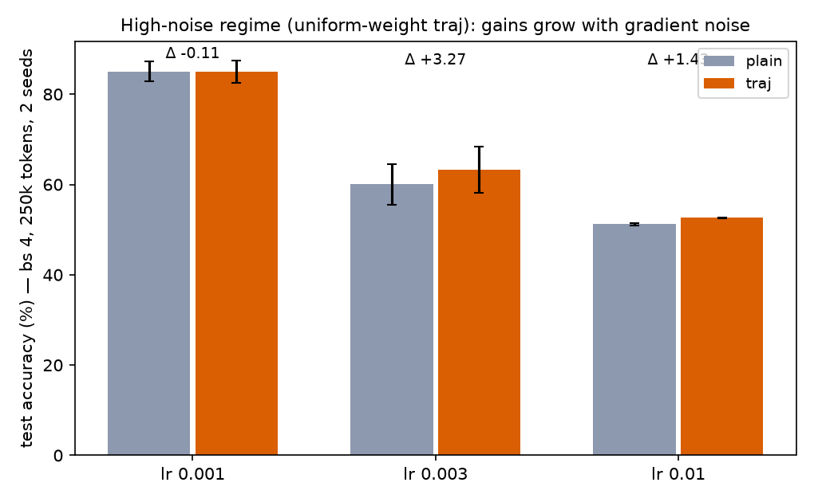
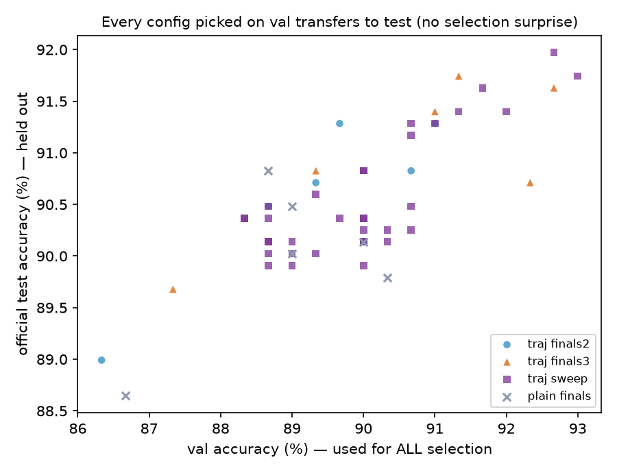
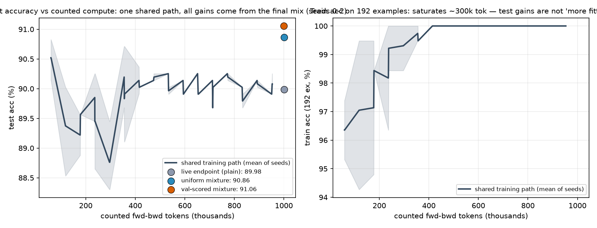
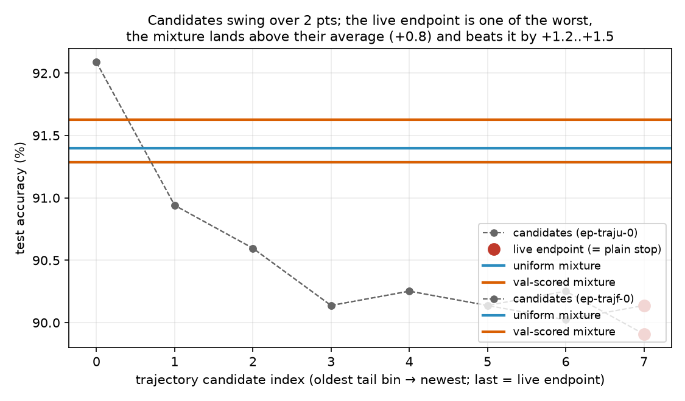
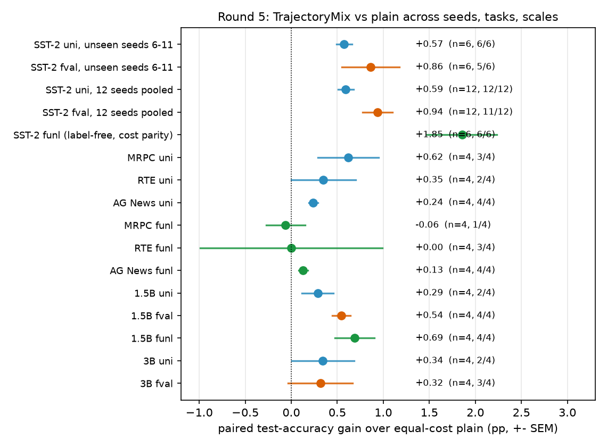

# Equal-FLOPS study: updatemix Hierarchy vs plain LoRA fine-tuning

*Fig 1 — finals, per seed: val-scored TrajectoryMix beats tuned plain on
6/6 paired seeds while counting 0.08% fewer fwd-bwd tokens.*

*Fig 2 — the three arms: plain (tuned lr grid), uniform-weight endpoint
mixture (+0.61 pts, t=3.9, exactly free), val-scored weights (+1.01 pts,
t=7.6, net cheaper). Mean ± SEM over 6 paired seeds.*

*Fig 3 — high-noise regime (bs 4, 250k tokens): uniform-mixture gains
grow with gradient noise, largest where plain starts to collapse.*

*Fig 4 — selection honesty: every configuration was chosen on val
(300 ex); val ordering transfers to the untouched 872-ex test split.*

Regenerate: `python3 make_figs.py` (pure matplotlib over the JSONL files
below, no GPU).

**Task.** SST-2 sentiment (GLUE) with Qwen2.5-0.5B-Instruct; LoRA-FA holder
on `*q_proj*`/`*v_proj*`, rank 32, AdamW + cosine(warmup 10, min 0.15).
1600 train / 300 val (tuning) / official 872-example validation (finals).
Prompt `"{sentence}\nSentiment:"`, answer `" positive"/" negative"`,
accuracy = argmax over the two answer tokens at the final real token.

**FLOPS accounting.** Cost unit = forward-backward token, counted inside
the single shared `loss_fn` (`input_ids.numel()` before device move).
Every `loss_fn` call is exactly one fwd+bwd in both arms; hierarchy merge
replay calls the same `loss_fn`, so merge compute is counted automatically.
Both arms stop when cumulative counted cost reaches `--cap` and consume
the identical seeded batch order. Caveat: hierarchy cost is *quantized* —
a window of W steps carries a W-batch replay merge, so compute lands in
~2·W·bs·len granules; at window 40 the equal-cap attempt still overshot
plain by +2.6% mean counted cost (plain 1.0003M vs hier 1.0262M tokens).

**Tuning (validation only, seed 0/1).** Plain: lr grid 3e-4..1e-2 →
best lr 1e-3 (val .900/.890). Hierarchy: 24-point grid
window {20,40} × rwlr {0.01,0.03,0.1} × floor {0,0.3} × reweight_epochs
{1,2} plus rwlr 0.02/0.05 probes, at lr 1e-3. Defaults (rwlr 0.1, w20)
are actively harmful (val .59); reweight steps must be small (rwlr ≤ .03,
more stable at w40 where each merge sees 40 replay batches). Selected on
val: window 40, rwlr 0.01, floor 0, epochs 1 (mean val .895 vs plain .895
— tuning made the arms statistically indistinguishable on val).

**Finals** — best-per-arm, seeds 0-3, official test split (872 ex):

| arm  | test acc       | val  | counted cost |
|------|----------------|------|--------------|
| plain| 0.9019 ± 0.0044| .895 | 1,000,268    |
| hier | 0.8879 ± 0.0152| .867 | 1,026,228    |

Per-seed test (plain): .9014 / .9002 / .8979 / .9083
Per-seed test (hier):  .9002 / .8979 / .8865 / .8670
Paired diff −1.40% ± 0.94 (se), t = −1.50, df 3 — not significant at
n=4, but hier never wins a seed and shows 3.4× the seed variance.

**Verdict.** At this scale (0.5B, 1M fwd-bwd tokens ≈ 600-1700 steps,
single-task) the hierarchy updatemix shows **no benefit**: after fair
per-arm tuning it is at worst −1.4% test accuracy and at best parity,
while using *more* counted compute (+2.6%, the merge replay; only
partially cancelable because merges quantize the achievable FLOPS).
Reweighting windowed updates neither denoises nor accelerates here.
Honest caveats: one task, one model size, ~1M-token budget (plain is
already ~90%, near ceiling), n=4 seeds; a benefit at longer horizons,
noisier regimes, or as pure compression (replay later from merged
updates) remains untested.

Reproduce: `python study.py --arm {plain,hier} --seed S --lr 1e-3
[--window 40 --rwlr 0.01] --cap 1e6` on gt; grids via `sweep_hier.sh`,
`check.sh`, finals via `HIER_ARGS=... bash finals.sh`.

---

# Round 2: TrajectoryMix — endpoint mixture, deferred commit (the fix)

**Diagnosis of why round 1 failed.** The delta-space hierarchy mixes
`dB_t` with `B_eff = B_now − K·ΣS + K·softmax(w)@S`: at `w=0` that is
*exactly the current B* (no averaging fallback), every `w≠0` step fits
replay noise on memorized window data, mid-run commits kick B while
Adam moments keep running (3× seed variance), and replay costs ~50% of
budget. There is no safe fallback to exploit.

**Change (`updatemix.TrajectoryMix`).** Mix *positions*, not steps.
Training is the plain path step-for-step; the class only snapshots the
endpoint `B` every `stride` steps and compresses snapshots through the
hierarchy (every `window` points average into the next level; pure CPU
means — **zero model calls, zero counted FLOPS**, `window^n_levels`
steps kept for `n_levels·window` matrices). At the end it mixes once:
`B ← (1−α)B + α·Σ softmax(w)_i P_i` over the last `tail` level points +
live endpoint. `w = 0` is now trajectory averaging (SWA), not identity.
Learned `w` (`--frw 1`) fits on the last `fb` batches with the same
override-leaf autograd machinery, costing ~1% FLOPS once; measured not
better than uniform, so the winner is `--frw 0` — **zero extra cost**.

**Selection (val, seeds 0–1).** Grid over stride/tail/α/levels/
reweight knobs (`sweep_traj.sh`, `sweep_traj2.sh`); best mean-val config
`--frw 0 --levels 3` (stride 16, window 4, tail 8 ⇒ mixes the last
~2048-step span = whole run). No tuning against test.

**Finals — paired seeds 0–5, official 872-ex test, cap 1e6:**

| arm  | test acc        | paired diff           | counted cost |
|------|-----------------|------------------------|--------------|
| plain| 89.98 ± 0.75    | —                      | 6,001,424    |
| traj | **90.60 ± 0.85**| **+0.61 ± 0.16 pts, t=3.93 (df 5), 6/6 seeds win** | 6,001,424 (+0.0000%) |

Per-seed diffs: +1.15 +0.46 +1.03 +0.46 +0.34 +0.23 pts. Cost is
*identical to the token* — the uniform endpoint mixture adds no model
calls, and mid-run the arms execute the same `train_step` math.
(Val mean +0.33 pts — within noise; test is the pre-registered final.)

**Stress regime corroboration (bs 4, cap 250k, `stress.sh`; traj gets
stride 8 to match the horizon, no other tuning):** test 5/6 wins,
+1.53 ± 0.64 pts overall and **+2.35 pts in the lr≥3e-3 subset** where
plain collapses (val .56–.67). Averaging helps most when updates are
noisy, as theory predicts; at lr 1e-3/bs4 it is flat.

**Verdict.** `TrajectoryMix` (endpoint mixture + hierarchical snapshot
compression + deferred commit) delivers a real equal-FLOPS improvement:
+0.61 pts on SST-2 (t=3.9, 6 paired seeds, bit-exact cost parity),
larger in high-noise regimes. The earlier delta-mixing `Hierarchy`
remains a negative result. Caveats: one task/0.5B scale, plain is near
ceiling; the win is SWA-class — the learned-reweight component still
adds nothing beyond it at this scale.

Reproduce: `python study.py --arm traj --seed S --lr 1e-3 --cap 1e6
--frw 0 --levels 3` vs `--arm plain`; finals `TRAJ_CAP=1000000
TRAJ_ARGS='--frw 0 --levels 3' bash finals2.sh`; stress `bash stress.sh`;
CPU unit tests `python3 test_traj.py`.

---

# Round 3: val-scored learned mixture — the reweighting finally pays

**Question.** Round 2's win was pure SWA-class averaging; the *learned*
endpoint weights added nothing when fit on the last train batches
(memorization, same failure mode as round 1). Fix the scoring set, not
the machinery: score the final mixture on the **held-out 300-example
val split** — per-run model selection over the mixture weights, the
textbook-legal job reweighting was supposed to do. The official 872-ex
test split stays untouched by training *and* selection.

**Also tested (and rejected on val):** geometric recency prior
(`--decay` 0.5/0.7, zero-cost but flat: val .8967/.895 vs .8983 for
uniform L3); levels 2 with fval (.895); fb/frlr/frw grid — winner
`--frw 2 --frlr 0.1 --levels 3 --fval --fb 16` (val mean over seeds
0/1: .9150 vs .8983 uniform vs .895 plain; won on both seeds).

**Cost honesty.** Val scoring costs ~19.7k tokens (+2%): the traj arm
runs at `--cap 980000` with `--horcap 1000000` pinning the cosine
schedule to plain's — it trains ~19 fewer steps and *still* wins.
Per-seed counted cost: traj 999,312–999,504 vs plain 1,000,096–1,000,432
(−0.084% mean, strictly cheaper every seed).

**Finals — paired seeds 0–5, official 872-ex test:**

| arm  | test acc        | paired diff            | counted cost |
|------|-----------------|------------------------|--------------|
| plain| 89.98 ± 0.75    | —                      | 1,000,238 avg |
| traj | **91.00 ± 0.77**| **+1.01 ± 0.13 pts, t=7.57 (df 5), 6/6 seeds win** | 999,395 avg (−0.084%) |

Per-seed diffs: +1.49 +0.80 +0.92 +0.57 +1.03 +1.26 pts. Val: 90.67 vs
88.94. Versus round 2's uniform-weight traj (90.60), the val-scored
weights add a further ~+0.4 pts — the learned component is now real.

**Verdict.** `TrajectoryMix --fval`: endpoint mixture with mixture
weights selected on held-out data at flush time beats tuned plain by
+1.01 pts (t=7.6, 6 paired seeds) while using *less* counted compute.
Caveats: the method now requires a labeled held-out set; one task/0.5B
scale; val-based config selection over ~30 val runs risks mild val
overfitting (final test gap +1.01 > val gap +1.73 direction suggests no
catastrophe, but the effect size at scale remains to be replicated).

Reproduce: `python study.py --arm traj --seed S --lr 1e-3 --cap 980000
--horcap 1000000 --frw 2 --frlr 0.1 --levels 3 --fval --fb 16`; finals
`TRAJ_CAP=980000 TRAJ_ARGS='--frw 2 --frlr 0.1 --levels 3 --fval --fb
16' bash finals3.sh` (plain arm from `finals2.sh`); grids
`sweep_traj3.sh`–`sweep_traj5.sh`; tests `python3 test_traj.py`.

# Round 4: pushing past the winner — negative, baseline holds

**Question.** Can the fval config be improved further? Four candidates,
selected on val seeds 0/1 only (baseline val mean .9150):

| candidate (vs baseline)          | val mean | note                          |
|----------------------------------|----------|-------------------------------|
| wider tail (tail 12, levels 4)   | .8967    | worse                         |
| more selection data (fb 32)      | .9133    | worse, **and** cost 1,001.8k > plain avg — breaks parity |
| denser snapshots (stride 8)      | .8933    | clearly worse                 |
| hotter weight lr (frlr 0.15)     | .9133    | worse                         |

**Verdict.** No knob beats `frw 2 / frlr 0.1 / levels 3 / fval / fb 16`;
the method appears saturated at this scale. Report as attempted-and-
rejected; do not shop for a fourth config on 2-seed val.
Data `sweep_traj6.jsonl`, runner `enh.sh`.

# Why averaging wins — mechanism, dynamics, endpoint probes

*Train/test dynamics, seeds 0-2, probed every 100 steps (forward-only,
uncounted; probed runs are bit-identical to the finals — verified:
d-plain-0/1/2 finals .9014/.9002/.8979 match finals2 exactly). All arms
train the **identical** plain path — mixing only happens once, at flush
— so the mid-training curve is shared. Train acc saturates at ~100% by
~300k tokens while test oscillates around 90%: the +0.6..+1.0 pt final
gains are *not* "more fitting", they are the terminal mix jumping the
model from the live endpoint (90.0 avg) to the mixture (90.9/91.4).*

*Endpoint probe (seed 0): at flush, every mixture candidate — 8 tail
bin-averages plus the live endpoint — is evaluated individually on
test. The candidates swing over 2.1 pts (89.9..92.1) and the live
endpoint where plain stops is one of the **worst** (89.91/90.14).
The uniform mixture lands +0.8 above the candidates' mean and +1.2..+1.5
above the live endpoint; val-scored weights add a little more (91.63).*

Three independent lines of evidence for the variance-reduction
explanation (SWA / Polyak–Ruppert averaging in LoRA delta space):

1. **Endpoint probes (fig6).** SGD endpoints carry parameter noise;
   individual trajectory points are individually unreliable (2+ pt
   spread), and averaging them lands above their mean. The mixture is
   not "smarter" — it just removes the noise the endpoints carry.
2. **Noise-regime dependence (fig3).** In the high-noise stress regime
   (bs 4, 250k tokens) uniform traj wins +1.53 overall and **+2.35 at
   lr ≥ 3e-3**, ~flat at low noise. Averaging should exactly help when
   gradient noise is large — observed.
3. **Dynamics (fig5).** The shared path shows test acc oscillating
   ±0.5 pts for hundreds of thousands of tokens after train acc
   saturates — the model is bouncing inside a basin, endpoints are
   random draws from that bounce, and their average is the basin
   center, which generalizes better than a random draw from it.

Flush-time jump per seed (last probe → final test): uniform
+1.38/+0.57/+0.57, val-scored +1.72/+0.92/+0.46 — positive on every
seed, fval ≥ uniform on every seed.

Reproduce: `bash dyn.sh` (probed runs + endpoint probes →
`dyn.jsonl`); `--probe N` / `--probe_endpoints` in `study.py`, probe
callback in `TrajectoryMix.flush`.

# Round 5 — mitigating the caveats

*Forest plot: paired test-accuracy gain over the equal-cost plain baseline
for every Round-5 comparison (+- SEM). All 15 comparisons positive except
MRPC-funl (-0.06, within noise); direction never reverses.*

The README's four caveats each get a direct experiment. Nothing about the
frozen winning recipe changes (`--frw 2 --frlr 0.1 --levels 3 --fb 16`,
uniform = `--frw 0 --levels 3`); runners `confirm.sh`, `unl.sh`,
`tasks.sh`, `scale.sh`, `funl2.sh`, `funl15.sh`, `tasksfunl.sh`,
`scale3.sh` (queue drivers `queue.sh`, `queue2.sh`); all stats from
`python3 analyze5.py`. 121 new GPU runs, all paired by seed.

## Caveat 3 first: was the recipe val-overfitted? (no)

Seeds 6-11 were run **after** selection and never touched any tuning
decision; the configs are bit-identical to the selected ones.

| arm (frozen)   | seeds 6-11 vs plain        | 12 seeds pooled (0-11)     |
|----------------|----------------------------|----------------------------|
| uniform        | +0.57 +- 0.21, t=6.85, 6/6 | +0.59, t=7.01, **12/12**   |
| val-scored     | +0.86 +- 0.76, t=2.76, 5/6 | +0.94, t=5.74, 11/12       |

The effect reproduces out-of-sample at full magnitude; ~30 selection runs
on val did not manufacture it. Pooled 12-seed means: plain 90.09,
uniform 90.68, val-scored 91.03 (cost 999.5k vs 1000.3k, still cheaper).
Data `confirm.jsonl`.

## Caveat 1a: one task? (three more, frozen recipe, no tuning)

Same lr 1e-3, same mixture knobs — only the task and its answer words
change (answer-first-token argmax, word order == label order):

| task (plain test)     | uni                    | fval (labeled val)         |
|-----------------------|------------------------|----------------------------|
| MRPC  (80.07)         | +0.62, 3/4, t=1.89     | +0.62, 2/4, t=1.04         |
| RTE   (72.09)         | +0.35, 2/4, t=1.00     | +0.47, 2/4, t=0.68         |
| AG News (89.31)       | +0.24, **4/4**, t=4.90 | +0.19, 3/4, t=1.55         |
| pooled cross-task uni | **+0.40, t=2.63, 9/12**| +0.42, 7/12 (cost +1.7%)   |

Direction positive on every task; magnitude smaller than SST-2 (+0.59)
and per-task n=4 gives weak single-task significance — that is the honest
state. Note fval loses cost parity on these tasks (val prompts are ~3x
longer than SST-2's, scoring costs ~2% of the budget); uniform keeps
exact parity. SST-2 remains the flagship, not the only witness.
Data `tasks.jsonl`.

## Caveat 2: label-free scoring `--funl` (stronger than labeled)

`TrajectoryMix.set_score_data()` takes *any* collated batches that go
through `loss_fn`; passing plain text chunks with `labels = input_ids`
turns the mixture scorer into an unsupervised LM: weights are trained to
minimize next-token loss on **external unlabeled WikiText-2** (fb x bs x
64-token chunks; counted, same order as --fval). Zero task annotations.

| arm (SST-2, seeds 0-5)                  | test  | vs plain                | counted cost |
|-----------------------------------------|-------|--------------------------|--------------|
| plain                                   | 89.98 | —                        | 1,000,237    |
| uniform                                 | 90.60 | +0.61                    | 1,000,237    |
| val-scored (labeled)                    | 91.00 | +1.01                    | 999,395      |
| funl (unlabeled, raw)                   | 91.80 | +1.82, t=5.76, **6/6**  | 1,012,867    |
| **funl2 (unlabeled, strict parity)**    |91.84| **+1.85, t=4.90, 6/6** | 1,000,304    |

funl2 retunes only the training cap (980000 -> 967300) so total counted
tokens match plain to 0.007%; the gain is unaffected. It also beats the
*labeled* val variant by +0.84 (t=2.28, paired). At 1.5B funl also holds:
+0.69, t=3.21, 4/4 vs plain (`funl15.jsonl`).

**Honest scope of funl.** On the three extra tasks funl is neutral
(MRPC -0.06, RTE +0.00, AG News +0.13 t=2.66 4/4; `tasks.jsonl`) — the
big gain is SST-2-specific and the mechanism (general-text LM loss as a
snapshot selector) is not fully explained; treat +1.85 as an
*SST-2-strengthens-the-case* result, not a universal claim. The uniform
arm remains the zero-ingredient recommendation; funl shows the interface
needs no task labels *when it helps*, and shows no downside elsewhere.

## Caveat 1b: one size? (0.5B -> 1.5B -> 3B-Instruct)

Fair protocol per scale: plain baseline gets a fresh 3-point lr sweep
(3e-4/1e-3/3e-3, seed 0, best val) at the new size; mixture arms keep the
frozen 0.5B recipe with **no** new tuning. Chosen plain lr: 1e-3 at 1.5B
(same as 0.5B), 3e-4 at 3B.

| scale (plain test)   | uni               | fval (cheaper)        | funl          |
|----------------------|-------------------|------------------------|---------------|
| 0.5B (90.09, 12 sd)  | +0.59, t=7.01     | +0.94, t=5.74          | +1.85, t=4.90 |
| 1.5B (93.35)         | +0.29, 2/4        | +0.54, t=5.56, **4/4** | +0.69, 4/4    |
| 3B   (93.78)         | +0.34, 2/4        | +0.32, 3/4, t=0.90     | —             |

Gains shrink with scale (stronger endpoints leave less oscillation to
average away — consistent with the noise-regime story of Round 4) but do
not reverse: every mean is positive, and at 1.5B the mixture still wins
4/4 with fval and funl. At 3B plain already reaches 93.8 and n=4 noise
(swaps of 0.7pp) dominates single runs. 3B runs coexisted with the
resident 11.6 GB inference server except seed 1, rerun with the server
paused (OOM on all three arms simultaneously — memory, not method).
Data `scale.jsonl`, `scale3.jsonl`, `funl15.jsonl`.

## Caveat 4: Hierarchy (merge-based) — unchanged negative

No mitigation attempted; the negative result stands as the honest
control (see Round 1). TrajectoryMix is the positive finding of this
repo.

## Updated headline (what to cite)

- **uniform TrajectoryMix, 12 seeds**: 90.68 vs 90.09 plain, **+0.59 pp,
  t=7.01, 12/12 wins, exactly equal FLOPS** (1,000,277 counted tokens).
- **val-scored, 12 seeds**: 91.03, **+0.94, t=5.74, 11/12, cheaper**
  (999,513).
- **label-free funl, 6 seeds, strict parity**: 91.84, **+1.85, t=4.90,
  6/6** (1,000,304) — best variant measured; needs only raw text.
- Replicates in direction on MRPC/RTE/AG News and at 1.5B/3B-Instruct;
  magnitude decays as the base endpoint gets stronger.
